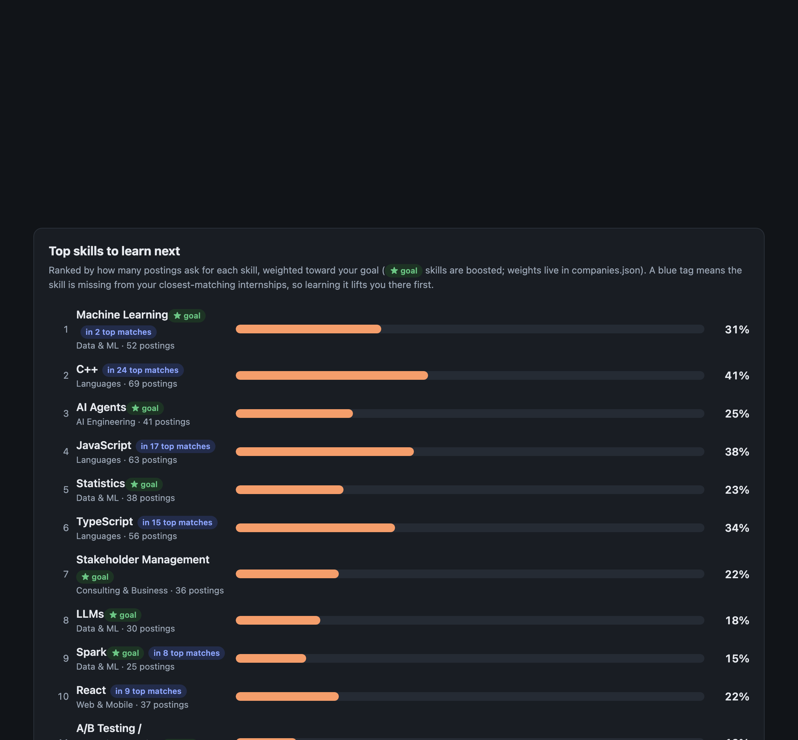
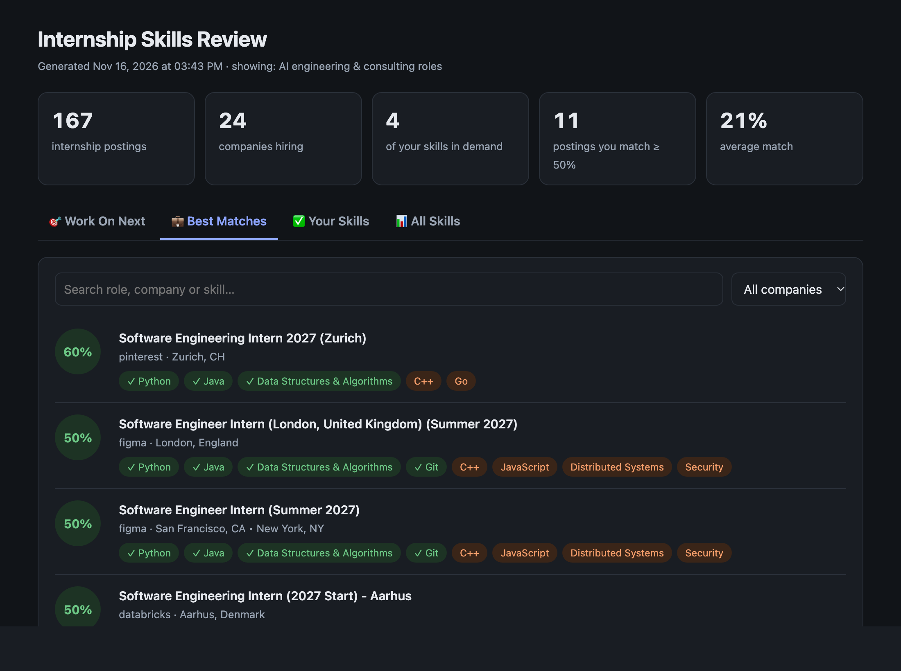
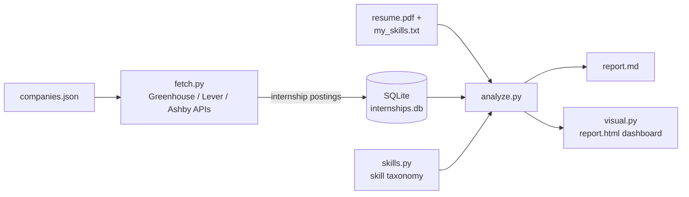

# Internship Skills Review


**Find out which skills internships actually want, which ones you already have, and what to learn next.**

The tool pulls live internship postings from the public job-board APIs of 35+ companies (Greenhouse, Lever and Ashby), extracts the skills each posting asks for, compares them against your resume, and generates an interactive dashboard ranking your skill gaps and best-matching roles.



## Features

- **Live data from three job-board APIs:** Greenhouse, Lever and Ashby, with no scraping and no API keys. Run it again to pick up new postings; closed ones age out automatically.
- **Resume parsing:** reads your PDF or text resume and detects 100+ skills across languages, ML, AI engineering, cloud and consulting.
- **Gap analysis:** ranks missing skills by how many postings ask for them, weighted toward your career goal (configurable).
- **Match scoring:** scores every internship by how many of its technical skills you have, and lists what you're missing for each one.
- **Interactive dashboard:** a self-contained HTML report with tabs, search and filters, in light and dark mode, with no front-end dependencies.
- **Tested:** 37 unit tests run on every push via GitHub Actions on Python 3.9, 3.11 and 3.13.



## How it works



1. **Fetch:** for each company in `companies.json`, call its public job-board endpoint, keep postings with *intern* or *co-op* in the title, and upsert them into SQLite.
2. **Extract:** match each posting's text against a skill taxonomy of regex aliases with custom word boundaries, so `C++`, `C#` and `.NET` match while "the *rest* of the team" doesn't count as REST and "AP Physics *C*" doesn't count as the C language.
3. **Compare:** build your profile from your resume and skills list, then compute skill demand, per-posting match scores and ranked gaps.
4. **Report:** print a summary, write `report.md`, and open the HTML dashboard.

## Quick start

```bash
git clone https://github.com/jackluehrs/internship-skills-review.git
cd internship-skills-review
pip install -r requirements.txt

cp my_skills.example.txt my_skills.txt   # list your skills, and/or…
cp ~/path/to/resume.pdf resume.pdf       # …drop in your resume

python main.py                           # fetch postings, then open the dashboard
```

| Command | What it does |
|---|---|
| `python main.py` | Fetch new postings, then generate and open the dashboard |
| `python main.py fetch` | Only pull postings into the database |
| `python main.py report [--role "data\|ml"] [--no-open]` | Generate reports, optionally filtered by job title |
| `python main.py add posting.txt --company acme --title "ML Intern"` | Add a posting copied from any other site |
| `python main.py list` | List postings in the database |

Your resume, skills list, database and reports are git-ignored, so personal data stays on your machine.

## Configuration

All settings live in [`companies.json`](companies.json):

- **Companies:** add a company's board name to the `greenhouse`, `lever` or `ashby` list. The name is the part after `boards.greenhouse.io/`, `jobs.lever.co/` or `jobs.ashbyhq.com/` in its careers links.
- **`role_filter`:** a regex applied to job titles (use `--role all` to see everything).
- **`goal_boost`:** category weights for the "Work On Next" ranking. For example, `"AI Engineering": 1.6` ranks AI skills higher.

To track a new skill, add it to `SKILLS` in [`skills.py`](skills.py) with its aliases.

## Project structure

```
├── main.py          # command-line entry point
├── fetch.py         # Greenhouse / Lever / Ashby API clients
├── db.py            # SQLite storage
├── skills.py        # skill taxonomy + extraction
├── analyze.py       # profile building, scoring, markdown report
├── visual.py        # HTML dashboard generator
├── companies.json   # companies, role filter, goal weights
└── tests/           # pytest suite
```

Run the tests with `pytest`.

## Roadmap

- [ ] LLM-based skill extraction (catch phrasing that keyword matching misses), evaluated against the keyword baseline
- [ ] Pull the SimplifyJobs community internship list for broader coverage
- [ ] Application tracker
- [ ] Scheduled daily fetch with GitHub Actions and an email digest of new top matches

## How this was built

I came up with the idea and directed Claude Code to build it, guiding the features and testing the results. I’m now working through the codebase to understand and extend it myself.

## License

MIT
